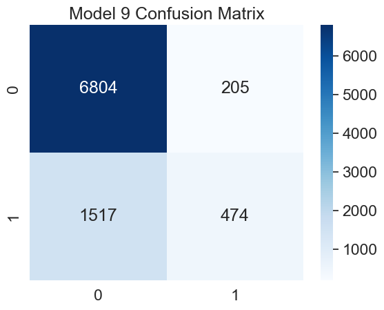
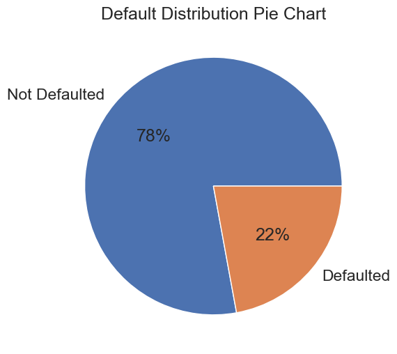

# Default of Credit Card Clients Classification Project

## Project Overview

A machine learning project that uses client data from the [UCI Default of Credit Card Clients Dataset](https://archive.ics.uci.edu/dataset/350/default+of+credit+card+clients) to predict clients defaulting on credit cards using Python and logistic regression.

## Installation

• Editor Used: VS Code

• Python Version: 3.13.11

## Python Packages

• Data Manipulation: Pandas, Numpy

• Data Visualization: Seaborn, Matplotlib

• Machine Learning: Scikit-learn

## Data

### [Source Data](https://archive.ics.uci.edu/dataset/350/default+of+credit+card+clients)

The dataset contains 25 client-related features from 30,000 unique individuals.

### Preprocessing

For documentation, I referred to [Kaggle](https://www.kaggle.com/datasets/uciml/default-of-credit-card-clients-dataset) as it contained the dataset's schema.

Before conducting EDA, there were several inconsistencies that had to be fixed first.

• <u>Feature Renaming</u>: PAY_0 was renamed to PAY_1 to maintain consistent sequential 
naming convention (1 through 6) with the rest of the features. 

• <u>Marital Status</u>: The dataset contained an unexpected 0 value for marital status, which 
diverged from the Kaggle schema. It was then merged to become 3 (unknown).

• <u>Education</u>: Similarly, there were more unaccounted 0 values and redundant 
‘unknown’ labels (5 and 6) which were mapped to 4 instead. 

• <u>Gender Coding</u>: The gender feature used non-standard binary encoding, so it was 
adjusted so that 0 meant female and 1 meant male. 


## Directory Structure

```text
Parkinson-s_Classification_Project/
├── data/
|   └── default_of_credit_card_clients.xls
├── images/
    └── conf.png
├── script/
|    └── script.ipynb
├── .gitignore
├── LICENSE.txt
├── README.md
└── requirements.txt
```

## Results and Evaluation for Class = 1

| # | Model | Accuracy | Precision | Recall | F1 | Coefs at zero |
| :-: | :--- | :--- | :--- | :--- | :--- | :--- |
| 1 | L2, C=1e10 (penalty ~off) | 0.8086 | 0.6976 | 0.2376 | 0.3544 | 0 |
| 2 | L2, C=0.01 | 0.8083 | 0.7052 | 0.2295 | 0.3463 | 0 |
| 3 | L2, C=0.1 | 0.8086 | 0.6988 | 0.2366 | 0.3535 | 0 |
| 4 | L2, C=1.0 | 0.8086 | 0.6976 | 0.2376 | 0.3544 | 0 |
| 5 | L2, C=10.0 | 0.8086 | 0.6976 | 0.2376 | 0.3544 | 0 |
| 6 | L1, C=0.01 | 0.8079 | 0.7155 | 0.2185 | 0.3347 | 8 |
| 7 | L1, C=0.05 | 0.8089 | 0.7069 | 0.2325 | 0.3500 | 5 |
| 8 | L1, C=0.1 | 0.8084 | 0.7001 | 0.2346 | 0.3514 | 3 |
| 9 | L1, C=1.0 | 0.8087 | 0.6981 | 0.2381 | 0.3551 | 2 |



From a bank's perspective, loss prevention is one of the highest priorities. To measure this, recall is the preferred metric because it ensures false negatives (missed defaults) are minimized.

Unfortunately, every model has low recall, averaging around the 21-23% range. Of these models, model 9 holds the largest recall (~24%), meaning that only 1 in every 4 clients likely to default is successfully noticed on average.

Across all models, precision is relatively high, averaging around the 70% mark. This is also vital because it ensures that banks avoid false positives — meaning that eligible credit card clients won't be turned down.

Because of the steep trade-off in recall and precision, F1 is low, ranging around the 35% mark. This indicates that the models struggle to find a healthy balance between high recall and high precision.


 ---


The low recall is most likely attributed to class imbalance, as approximately 22% of the dataset consists of clients who defaulted. Because of this, the models naturally favor the majority 'not defaulted' class, tanking recall for the 'defaulted' class as a result.

## Future Work

This project serves as a machine learning benchmark and not a means to create deployable models. In future iterations, several avenues could be explored to improve predictive performance:

• Handling Class Imbalance: Use of oversampling techniques like SMOTE or cost-sensitive learning could better penalize false negatives without introducing synthetic noise.

• Alternative Model Methods: As this project tested only Logistic Regression, a linear model, future work could test whether non-linear patterns in the data exist. Some examples include Random Forest or XGBoost.

• Decision Threshold Optimization: Tailoring the classification probability threshold through Precision-Recall curve analysis to find the optimal trade-off for a particular bank helps answer their unique financial/business needs

## License & Acknowledgements

### Dataset Attribution

The Dataset used in this project comes from the [UCI Default of Credit Card Clients Dataset](https://archive.ics.uci.edu/dataset/350/default+of+credit+card+clients).

### License

[MIT License](LICENSE.txt)


## Installation Process
Below are the steps one can follow to access a copy of this repository via cmd:

`git clone  https://github.com/Keaton-D/Default_of_Credit_Card_Clients_Classification_Project`

`cd Default_of_Credit_Card_Clients_Classification_Project`

`python -m venv .venv`

`.venv\Scripts\activate`

`pip install -r REQUIREMENTS.txt`

`jupyter notebook`

`notebook/script.ipynb`